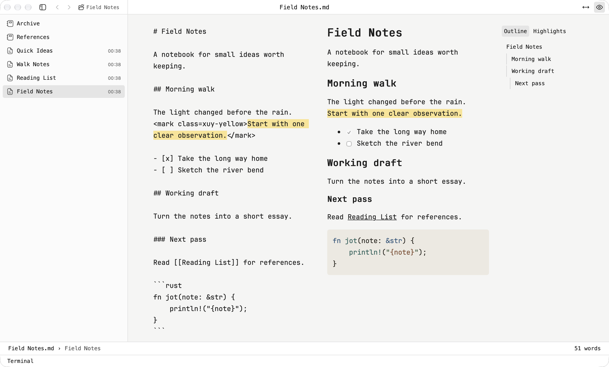
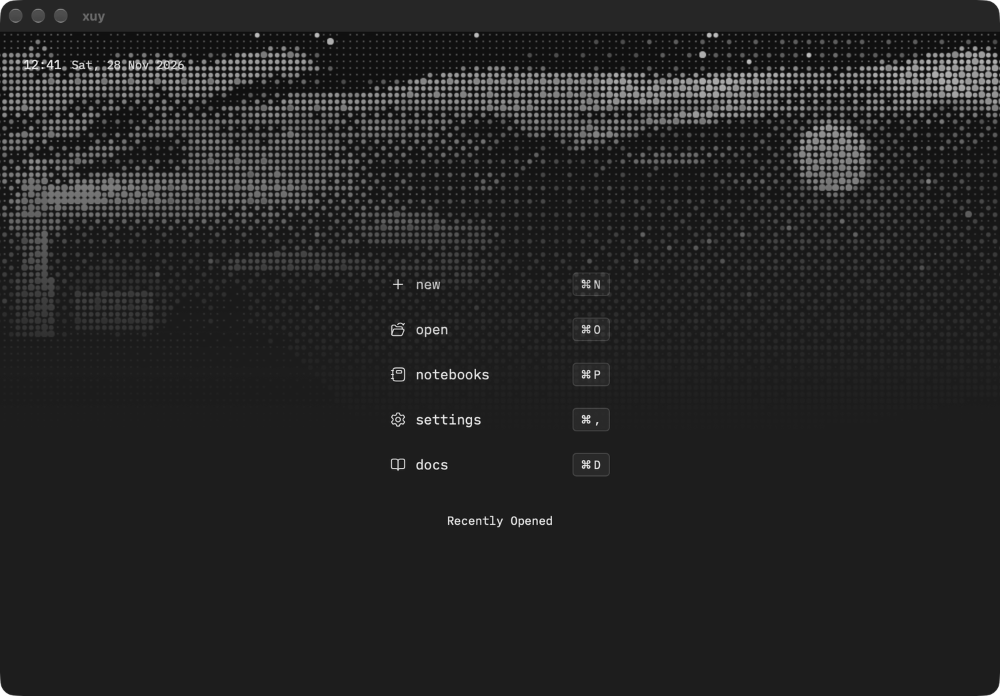
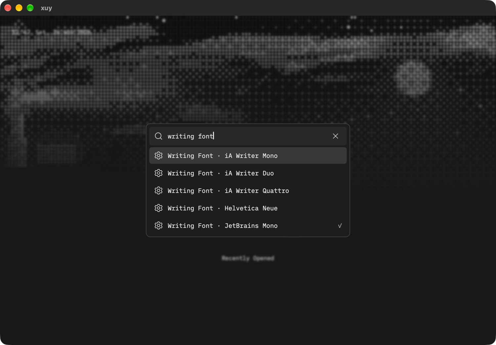

# xuy

**A Rust desktop app built for fast Markdown editing.**

Open a folder on macOS or Linux and start writing. xuy reads notes on demand, renders the preview in the background, and saves directly to the Markdown files you already have.

[Download xuy](https://github.com/vimzh/xuy/releases/latest) · [User guide](docs/usage.md)



## How xuy keeps editing responsive

- **Open the folder you need.** xuy lists the current folder and reads each note when you open it.
- **Keep typing while the preview renders.** Rust renders Markdown on a background worker after a short pause in typing. Autosave waits for one second of idle time before writing to disk.
- **See what xuy uses on your machine.** On macOS, press `⌘I` to see live CPU usage and memory footprint for the main xuy process. [Performance panel guide](docs/usage.md#check-performance)

## Install

| Platform | v0.1.2 download |
| --- | --- |
| macOS 14.5+, Apple Silicon | [Apple Silicon DMG](https://github.com/vimzh/xuy/releases/download/v0.1.2/xuy-0.1.2-macos-arm64.dmg) |
| macOS 14.5+, Intel | [Intel DMG](https://github.com/vimzh/xuy/releases/download/v0.1.2/xuy-0.1.2-macos-x86_64.dmg) |
| Ubuntu 24.04, x86-64 | [Linux DEB](https://github.com/vimzh/xuy/releases/download/v0.1.2/xuy-0.1.2-linux-amd64.deb) |

**macOS.** Open the DMG and drag **Xuy** into **Applications**. The app uses an ad hoc signature and is unnotarized. If macOS blocks the first launch, see [Apple’s instructions for opening the app](https://support.apple.com/en-us/102445).

**Linux.** From your download directory, run `sudo apt install ./xuy-0.1.2-linux-amd64.deb`. The Linux build is a preview. Notes persist on disk, and saved notebook shortcuts and several preferences reset when you relaunch. Session restore and the performance panel are currently macOS-only.

[Release notes](https://github.com/vimzh/xuy/releases/tag/v0.1.2) · [SHA-256 checksums](https://github.com/vimzh/xuy/releases/download/v0.1.2/SHA256SUMS)

## Start writing

1. Choose **open** on Home to browse an existing folder, or **notebooks** to add a folder you want to return to.
2. Open a Markdown file, or choose **new** on Home to create one. xuy saves after one second without edits.
3. Use the view menu to switch between **Edit**, **Preview**, and **Side by Side**. Select a heading in the right sidebar to jump to that section.

| Home | Command bar |
| --- | --- |
|  |  |

The screenshots are from xuy running on macOS with a sample notebook.

Press `⌘K` on macOS to find commands and settings while you write. The full guide covers shortcuts, the terminal, and editing the same files from other tools. It’s available offline from **docs** on Home. [User guide](docs/usage.md)

## Develop

Built with Rust and Dioxus Desktop. Install [stable Rust](https://rustup.rs/) and [Dioxus CLI 0.7.10](https://github.com/DioxusLabs/dioxus/releases/tag/v0.7.10).

On Ubuntu 24.04, install the desktop build dependencies and the portal used by the file picker.

```sh
sudo apt install pkg-config libgtk-3-dev libwebkit2gtk-4.1-dev libxdo-dev xdg-desktop-portal xdg-desktop-portal-gtk
```

```sh
git clone https://github.com/vimzh/xuy.git
cd xuy
dx serve --desktop
```

Run the project checks before committing changes to Rust code.

```sh
cargo fmt --check
cargo clippy --locked --all-targets -- -D warnings
cargo test --locked
```

The [product brief](PRD.md) covers the design and requirements.

## Credits

Home scenes by [ascii.rest](assets/ascii-rest/LICENSE.txt). Icons by [Hugeicons](assets/hugeicons/LICENSE.md). Bundled typefaces by [iA Writer](assets/writing-fonts/LICENSE-iA-Writer.md) and [JetBrains Mono](assets/writing-fonts/OFL-JetBrains.txt). The terminal uses [xterm.js](assets/xterm/LICENSE-xterm.txt) and its [fit addon](assets/xterm/LICENSE-addon-fit.txt).
